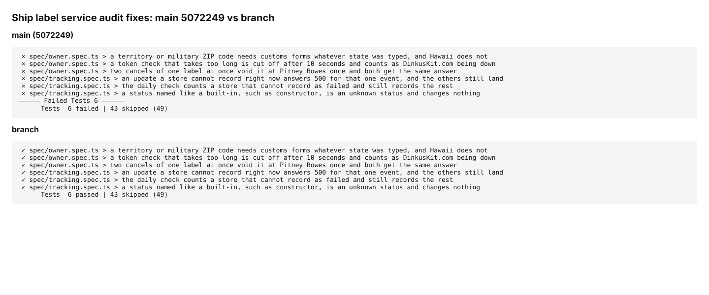

# Label service audit fixes (25 Nov 2026)

The owner approved these fixes on 25 Nov 2026. Each one has a test in `service/spec` that fails on main (5072249) and passes on this branch.

| Fix | Test |
| --- | --- |
| A territory or military ZIP code needs customs forms even when a state's name was typed; Hawaii and Alaska still get labels | `owner.spec.ts` "a territory or military ZIP code needs customs forms…" |
| Two Cancel label presses at once void the label at Pitney Bowes once and both get the same answer | `owner.spec.ts` "two cancels of one label at once…" |
| The DinkusKit.com token check is cut off after 10 seconds and counts as DinkusKit.com being down (the session keeps its grace window) | `owner.spec.ts` "a token check that takes too long…" |
| A tracking update one store cannot record answers 500 in its own row; the other events still land | `tracking.spec.ts` "an update a store cannot record right now…" |
| The daily check counts that store as failed and records the rest | `tracking.spec.ts` "the daily check counts a store that cannot record…" |
| A status named like a built-in (`constructor`, `toString`, `__proto__`) is unknown and changes nothing | `tracking.spec.ts` "a status named like a built-in…" |

- [main.txt](main.txt): the six tests against main's `service/src`: 6 failed.
- [branch.txt](branch.txt): the same tests on this branch: 6 passed.
- 

Reproduce from `service/`: `npx vitest run spec/owner.spec.ts spec/tracking.spec.ts -t "too long|customs forms whatever|two cancels|cannot record|built-in" --reporter=verbose`.
